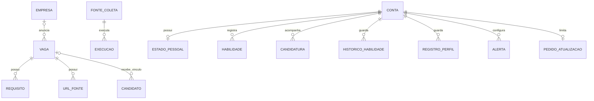

# Projeto e dicionário de dados do BANCO 2027

O banco PostgreSQL no Supabase mantém o catálogo, o histórico do mercado, os dados da conta e o processamento interno de fontes. O [esquema físico versionado](../../../supabase/schema.sql) e as [migrações](../../../supabase/migrations/) registram a implementação.

## Modelo conceitual

Uma empresa pode anunciar várias vagas, e cada vaga pode ter requisitos e URLs de origem. Um candidato à publicação pode ser associado a uma vaga publicada. Uma fonte de coleta tem várias execuções. A conta do usuário pode manter um perfil com habilidades, candidaturas, histórico e alertas. Os registros de mercado representam semanas de observação.

O diagrama mostra como as entidades se relacionam. O dicionário descreve as chaves usadas para implementar essas relações.

## Modelo lógico

| Núcleo | Relações e chaves |
|---|---|
| Catálogo | `companies(name)` identifica a empresa. `jobs(key)` identifica o anúncio e referencia a empresa quando definida. `job_requirements(job_key, mandatory, position)` separa os itens e `job_sources(job_key, url)` separa as origens. As duas tabelas referenciam `jobs(key)`. |
| Mercado | `market_snapshots(week)` identifica cada semana. `collection_meta(id)` conserva os metadados da coleta, incluindo o registro `current` consumido pela API. |
| Dados pessoais | `user_state(user_id)` mantém a representação da sessão. As projeções `skills(user_id, skill_id)`, `applications(user_id, job_key)`, `skill_history(user_id, position)`, `profile_snapshots(user_id, position)` e `alerts(user_id, key)` compartilham o identificador da conta em `auth.users`. `refresh_requests(user_id)` controla o intervalo entre atualizações. |
| Coleta | `source_registry(id)` guarda a configuração por origem. `source_runs(id)` referencia `source_registry(id)`. `job_candidates(candidate_key)` mantém uma fila independente, com vínculo opcional a `jobs(key)` no momento da publicação. O par `(provider, external_id)` tem restrição de unicidade. |

A separação de requisitos, fontes, habilidades e candidaturas remove grupos repetidos das entidades centrais. As tabelas relacionais usam chaves próprias e compostas conforme a identidade do registro. O esquema físico conserva também representações em JSONB para entrega do catálogo, reprodução do estado pessoal e dados de fontes com estruturas variáveis. Essa duplicação é deliberada. A função `save_career_state` atualiza o JSONB e as projeções pessoais na mesma transação. `applications.job_key` guarda a chave da vaga e o esquema permite representar candidaturas mesmo quando o catálogo muda, pois essa coluna não tem chave estrangeira para `jobs`.

## Projeto físico

- **SGBD e implantação.** PostgreSQL no Supabase. Para instalação nova ou atualização de uma instância existente, siga as [instruções do repositório](../../../README.md#ativar-vercel--supabase) e a ordem aplicável de migrações.
- **Integridade.** O SQL declara chaves primárias, chaves estrangeiras, unicidade e validações de domínio. `job_candidates` acompanha tentativas e liga o registro publicado ao catálogo. Se a vaga publicada for removida, o vínculo no candidato fica nulo.
- **Acesso.** As tabelas de catálogo têm leitura pública. As tabelas pessoais expostas aplicam RLS por `auth.uid()`. As tabelas internas de fontes e candidatos são restritas ao papel de serviço. A tabela `refresh_requests` é manejada pela função de controle de intervalo.
- **Operação.** A API pública lê o catálogo e os metadados. A sincronização pessoal chama `save_career_state`. A solicitação de atualização usa `claim_refresh`, que aplica o intervalo de cinco minutos por usuário. Os índices de candidatos cobrem processamento, deduplicação, provedor e vínculo publicado. O índice de execuções cobre fonte e horário de início.
- **Estado local.** Favoritos e filtros ficam no navegador. O catálogo estático dá suporte à consulta quando a API de vagas fica indisponível. O dicionário a seguir descreve as tabelas do PostgreSQL.

## Dicionário de dados

PK indica chave primária. As definições da segunda coluna foram extraídas do esquema físico. Nas chaves compostas, as restrições aparecem na coluna ou logo abaixo da tabela.

### companies

| Campo | Tipo e restrições declaradas | Uso |
|---|---|---|
| `name` | `text primary key` | Nome canônico da empresa. |
| `domain` | `text` | Domínio associado à empresa. |

### jobs

| Campo | Tipo e restrições declaradas | Uso |
|---|---|---|
| `key` | `text primary key` | Chave estável da oportunidade no catálogo. |
| `company` | `text references public.companies(name)` | Empresa vinculada à oportunidade. |
| `payload` | `jsonb not null` | Representação da vaga entregue pela API, com cargo, requisitos e contexto. |
| `updated_at` | `timestamptz not null default now()` | Horário da atualização do registro. |

### job_requirements

| Campo | Tipo e restrições declaradas | Uso |
|---|---|---|
| `job_key` | `text references public.jobs(key)` | Vaga à qual o item pertence. |
| `position` | `integer` | Ordem do item no grupo de requisitos. |
| `mandatory` | `boolean not null` | Indica se o item pertence ao grupo obrigatório. |
| `requirement` | `text not null` | Texto do requisito coletado. |
| `requirement_type` | `text not null default 'mandatory' check(requirement_type in ('mandatory','differential','eliminatory'))` | Classificação entre obrigatório, diferencial ou eliminatório. |
| `category` | `text not null default 'other' check(category in ('technical','experience','education','language','location','modality','eligibility','behavioral','domain','other'))` | Categoria de requisito usada na interpretação. |
| `skill` | `text` | Habilidade identificada no texto. |
| `subskill` | `text` | Habilidade específica ou derivada. |
| `required_level` | `smallint check(required_level between 1 and 4)` | Nível explícito exigido, quando mapeado. |
| `min_years` | `numeric(4,1) check(min_years >= 0)` | Tempo mínimo de experiência identificado. |
| `transferable` | `boolean not null default false` | Indica se é possível considerar habilidade transferível. |
| `relation` | `text not null default 'single' check(relation in ('single','any','all'))` | Relação entre alternativas ou itens exigidos. |
| `profile_skill_ids` | `text[] not null default '{}'` | Identificadores das habilidades no perfil. |
| `attributes` | `jsonb not null default '{}'` | Atributos estruturados adicionais do requisito. |

Restrições da tabela: `primary key(job_key,mandatory,position)`.

### job_sources

| Campo | Tipo e restrições declaradas | Uso |
|---|---|---|
| `job_key` | `text references public.jobs(key)` | Vaga associada ao endereço. |
| `url` | `text not null` | Endereço da fonte do anúncio. |
| `last_verified_at` | `timestamptz` | Horário da última verificação dessa fonte. |

Restrições da tabela: `primary key(job_key,url)`.

### collection_meta

| Campo | Tipo e restrições declaradas | Uso |
|---|---|---|
| `id` | `text primary key` | Identificador do conjunto de metadados. |
| `payload` | `jsonb not null` | Resumo estruturado da coleta e validação. |

### market_snapshots

| Campo | Tipo e restrições declaradas | Uso |
|---|---|---|
| `week` | `date primary key` | Semana de referência do registro de mercado. |
| `payload` | `jsonb not null` | Indicadores de mercado registrados na semana. |

### user_state

| Campo | Tipo e restrições declaradas | Uso |
|---|---|---|
| `user_id` | `uuid primary key references auth.users(id) on delete cascade` | Conta proprietária do estado pessoal. |
| `payload` | `jsonb not null` | Estado sincronizado da interface, incluindo perfil e candidaturas. |
| `updated_at` | `timestamptz default now()` | Horário da última atualização do estado. |

### skills

| Campo | Tipo e restrições declaradas | Uso |
|---|---|---|
| `user_id` | `uuid references auth.users(id) on delete cascade` | Conta proprietária da habilidade registrada. |
| `skill_id` | `text` | Identificador da habilidade no motor de aderência. |
| `level` | `smallint check(level between 0 and 4)` | Nível informado no perfil. |
| `evidence` | `smallint check(evidence between 0 and 4)` | Nível de evidência informado. |
| `note` | `text` | Observação sobre a habilidade. |

Restrições da tabela: `primary key(user_id,skill_id)`.

### skill_history

| Campo | Tipo e restrições declaradas | Uso |
|---|---|---|
| `user_id` | `uuid references auth.users(id) on delete cascade` | Conta proprietária do histórico. |
| `position` | `integer` | Posição do evento na série. |
| `payload` | `jsonb not null` | Evento de evolução da habilidade. |

Restrições da tabela: `primary key(user_id,position)`.

### applications

| Campo | Tipo e restrições declaradas | Uso |
|---|---|---|
| `user_id` | `uuid references auth.users(id) on delete cascade` | Conta proprietária da candidatura. |
| `job_key` | `text` | Chave da oportunidade associada à candidatura. |
| `payload` | `jsonb not null` | Estado da candidatura, com etapa e demais dados gravados pela interface. |

Restrições da tabela: `primary key(user_id,job_key)`.

### alerts

| Campo | Tipo e restrições declaradas | Uso |
|---|---|---|
| `user_id` | `uuid references auth.users(id) on delete cascade` | Conta proprietária da configuração de alertas. |
| `key` | `text` | Identificador do conjunto de alertas. |
| `payload` | `jsonb not null` | Regras e alertas descartados. |

Restrições da tabela: `primary key(user_id,key)`.

### profile_snapshots

| Campo | Tipo e restrições declaradas | Uso |
|---|---|---|
| `user_id` | `uuid references auth.users(id) on delete cascade` | Conta proprietária da série de perfil. |
| `position` | `integer` | Posição do registro na série. |
| `payload` | `jsonb not null` | Retrato de compatibilidade e habilidades no momento do registro. |

Restrições da tabela: `primary key(user_id,position)`.

### refresh_requests

| Campo | Tipo e restrições declaradas | Uso |
|---|---|---|
| `user_id` | `uuid primary key references auth.users(id) on delete cascade` | Conta associada ao controle do intervalo. |
| `requested_at` | `timestamptz not null` | Horário da solicitação mais recente aceita. |

### source_registry

| Campo | Tipo e restrições declaradas | Uso |
|---|---|---|
| `id` | `text primary key` | Identificador da fonte de coleta. |
| `provider` | `text not null` | Provedor ou adaptador da fonte. |
| `display_name` | `text not null` | Nome de exibição da fonte. |
| `base_url` | `text not null` | Endereço base usado pela integração. |
| `priority` | `smallint not null default 3 check(priority between 1 and 5)` | Prioridade configurada para processamento. |
| `enabled` | `boolean not null default false` | Indica se a fonte está habilitada. |
| `credentials_required` | `boolean not null default false` | Indica se a integração exige credencial. |
| `daily_request_limit` | `integer check(daily_request_limit is null or daily_request_limit > 0)` | Limite diário de chamadas, se configurado. |
| `lifetime_request_limit` | `integer check(lifetime_request_limit is null or lifetime_request_limit > 0)` | Limite total de chamadas, se configurado. |
| `health_status` | `text not null default 'unknown' check(health_status in ('unknown','healthy','degraded','unavailable','quota_exhausted','credentials_missing'))` | Resultado de saúde operacional da fonte. |
| `last_success_at` | `timestamptz` | Horário do último sucesso. |
| `last_failure_at` | `timestamptz` | Horário da última falha. |
| `consecutive_failures` | `integer not null default 0 check(consecutive_failures >= 0)` | Quantidade de falhas consecutivas. |
| `last_error` | `text` | Descrição do último erro conhecido. |
| `metadata` | `jsonb not null default '{}'` | Dados complementares sobre a origem. |
| `updated_at` | `timestamptz not null default now()` | Horário da última atualização do registro. |

### job_candidates

| Campo | Tipo e restrições declaradas | Uso |
|---|---|---|
| `candidate_key` | `text primary key` | Identificador do candidato à publicação. |
| `provider` | `text not null` | Provedor que retornou o candidato. |
| `external_id` | `text` | Identificador externo, quando informado. |
| `source_url` | `text not null` | Endereço de origem do candidato. |
| `apply_url` | `text` | Endereço de candidatura, quando informado. |
| `title_raw` | `text not null default ''` | Título original recebido. |
| `company_raw` | `text not null default ''` | Empresa conforme a fonte. |
| `location_raw` | `text not null default ''` | Localização conforme a fonte. |
| `description_raw` | `text not null default ''` | Descrição original preservada. |
| `published_at` | `timestamptz` | Data de publicação informada pela fonte. |
| `source_updated_at` | `timestamptz` | Horário da alteração informada pela fonte. |
| `first_discovered_at` | `timestamptz not null default now()` | Horário em que o candidato foi encontrado pela primeira vez. |
| `last_discovered_at` | `timestamptz not null default now()` | Horário da detecção mais recente. |
| `processing_status` | `text not null default 'discovered' check(processing_status in ('discovered','qualified','review_required','rejected','published','closed'))` | Etapa do processamento do candidato. |
| `attempt_count` | `integer not null default 0 check(attempt_count >= 0)` | Quantidade de tentativas de processamento. |
| `next_retry_at` | `timestamptz` | Horário previsto para nova tentativa. |
| `rejection_reason` | `text` | Motivo registrado quando rejeitado. |
| `payload_hash` | `text not null` | Identificador de conteúdo para detectar alterações. |
| `dedupe_key` | `text not null` | Chave usada para procurar duplicatas. |
| `qualification` | `jsonb not null default '{}'` | Dados e motivos da qualificação. |
| `raw_payload` | `jsonb not null default '{}'` | Resposta original estruturada da fonte. |
| `published_job_key` | `text references public.jobs(key) on delete set null` | Vaga publicada à qual o candidato foi associado. |

Restrições da tabela: `unique(provider,external_id)`.

### source_runs

| Campo | Tipo e restrições declaradas | Uso |
|---|---|---|
| `id` | `bigint generated by default as identity primary key` | Identificador gerado para a execução. |
| `source_id` | `text not null references public.source_registry(id)` | Fonte processada na execução. |
| `started_at` | `timestamptz not null` | Horário de início. |
| `finished_at` | `timestamptz not null default now()` | Horário de término. |
| `status` | `text not null check(status in ('success','partial','failed','skipped'))` | Resultado operacional da execução. |
| `request_count` | `integer not null default 0 check(request_count >= 0)` | Quantidade de chamadas realizadas. |
| `discovered_count` | `integer not null default 0 check(discovered_count >= 0)` | Quantidade de candidatos descobertos. |
| `persisted_count` | `integer not null default 0 check(persisted_count >= 0)` | Quantidade de candidatos persistidos. |
| `error_count` | `integer not null default 0 check(error_count >= 0)` | Quantidade de falhas contabilizadas. |
| `error` | `text` | Descrição de erro, quando disponível. |
| `metadata` | `jsonb not null default '{}'` | Métricas e detalhes adicionais. |
