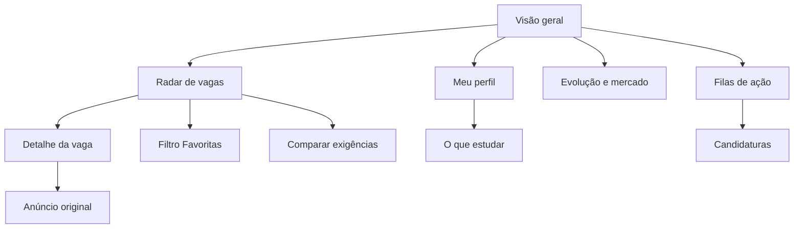

# Interface e protótipo do BANCO 2027

O protótipo textual registra o fluxo da aplicação publicada. Os rótulos abaixo identificam os controles centrais do recorte.

## Mapa de navegação



## Radar e detalhe

```text
BANCO 2027                     Rascunho neste navegador
Navegação: Visão geral | Radar de vagas | Meu perfil | ...

Radar de vagas
Buscar [__________________]   Empresa [Todos v]
Área   [Todos v]              Stack   [Todos v]
[ ] Favoritas                 [Limpar filtros]

Resultado: total de vagas e itens em revisão
Empresa · Cargo · Situação do anúncio
[Abrir detalhe] [Favoritar] [Comparar]

Detalhe da vaga
Empresa · Cargo · Situação · Link da fonte
Obrigatórios | Diferenciais | Responsabilidades (quando disponíveis)
```

[Experimentar o Radar de vagas](https://banco-2027.vercel.app/#jobs)

## Estados de interface

| Contexto | Comportamento ou mensagem |
|---|---|
| Nenhuma vaga atende aos filtros | A lista exibe “Nenhuma vaga combina com estes filtros.” A ação Limpar filtros restaura os critérios padrão. |
| Link de vaga não reconhecido | O detalhe exibe “Vaga não encontrada.” |
| API indisponível | A interface mantém a última cópia publicada do catálogo e exibe “Base online indisponível. Exibindo a última cópia publicada.” |
| Falha ao gravar no navegador | A interface informa “Não foi possível salvar neste navegador. Exporte um backup.” |
| Sessão pública | O cabeçalho identifica o estado pessoal com “Rascunho neste navegador”. |
| Evolução sem registros suficientes | A interface informa que são necessários dois registros históricos em datas diferentes para calcular a tendência. |

## Revisão de IHC

O roteiro de navegação mantém a busca, os filtros e o contador na mesma tela. Os botões de favoritar e comparar ficam associados ao cartão da vaga. A comparação apresenta as exigências lado a lado. A reprodução em tela estreita deve manter campos, títulos e ações legíveis.

| Ponto observado | Ajuste ou reteste proposto |
|---|---|
| No filtro Favoritas, um único resultado pode aparecer como “1 vagas”. | Ajustar o singular e retestar o contador com zero, um e vários resultados. |
| A vaga de Monitoração Financeira do C6 Bank contém atividades na seção Obrigatórios, como “Elaborar queries em SQL para extração, manipulação e análise de dados”. | Conferir a divisão das seções na fonte, separar atividades de requisitos durante a coleta e retestar o mesmo detalhe depois de publicar o catálogo atualizado. [Caso reproduzível](https://banco-2027.vercel.app/#job/job-boards.greenhouse.io%2Fc6bank%2Fjobs%2F4733675005) |
| O painel de demanda depende de registros no intervalo escolhido. | Testar tanto um período com registros suficientes quanto outro que apresente a mensagem de dados insuficientes. |

## Critérios de verificação

Abrir o Radar em uma janela estreita, navegar por teclado até os filtros, testar uma busca sem retorno, favoritar e filtrar uma vaga e comparar duas vagas. Para cada caso, registrar a URL, o resultado e a captura de tela quando houver desvio.
