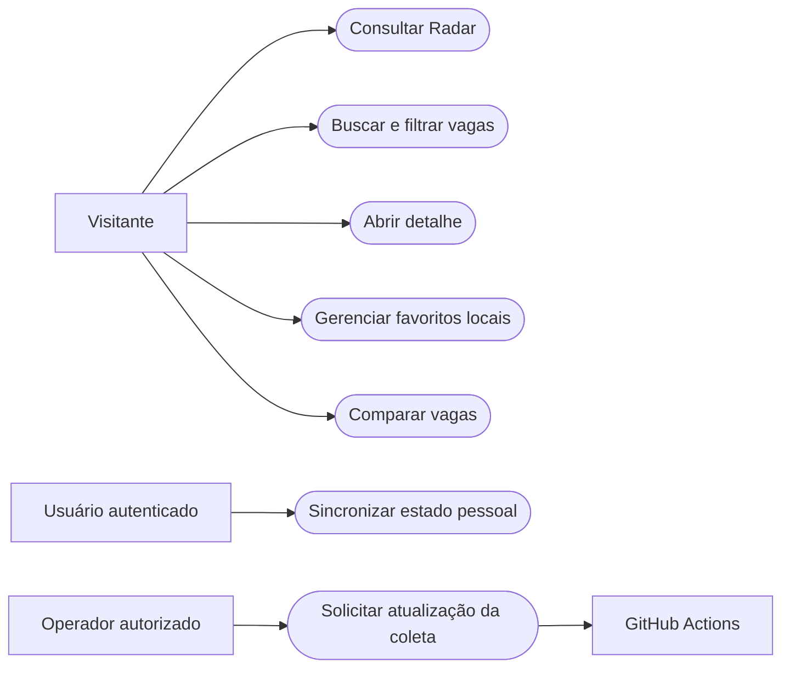
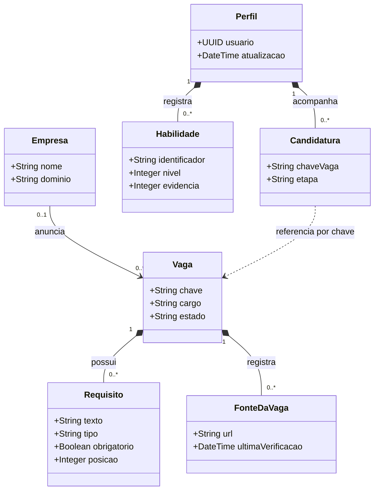
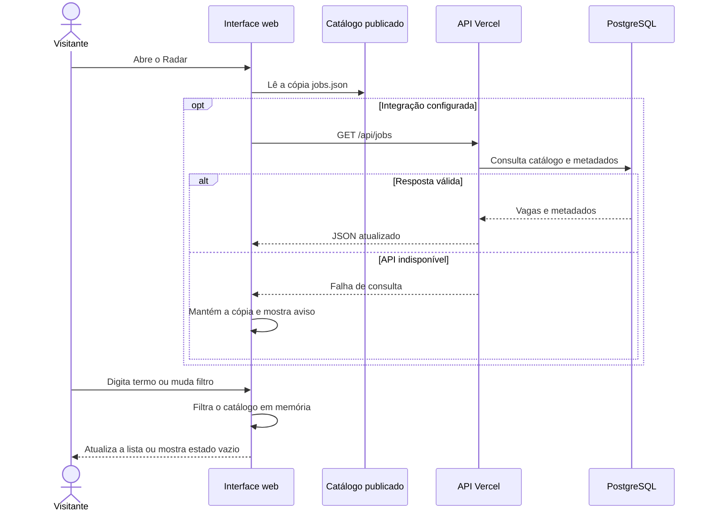
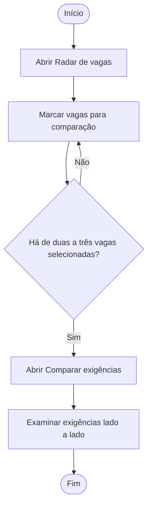

# Modelagem UML do BANCO 2027

Os diagramas descrevem o recorte de consulta e as fronteiras do sistema. Os nomes das classes representam conceitos de domínio.

## Casos de uso

## Diagrama de classes do domínio

O mapa de persistência relaciona Empresa a `companies`, Vaga a `jobs`, Requisito a `job_requirements` e FonteDaVaga a `job_sources`. Perfil é representado por `user_state` e pelas projeções `skills` e `applications`. A ligação de candidatura com vaga é conceitual. A coluna `applications.job_key` faz a associação por chave no código.

## Diagrama de sequência da consulta

## Diagrama de atividades da comparação

## Implementação de referência

| Responsabilidade | Arquivos |
|---|---|
| Visualização, eventos e rotas da interface | [index.html](../../../index.html), [styles.css](../../../styles.css) e [app.js](../../../app.js) |
| Regras de aderência e priorização | [engine.js](../../../engine.js) |
| Rotas HTTP e acesso a serviços | [jobs.js](../../../api/jobs.js), [state.js](../../../api/state.js) e [server.js](../../../lib/server.js) |
| Coleta e publicação do catálogo | [update_vagas.py](../../../scripts/update_vagas.py) e [sync_database.py](../../../scripts/sync_database.py) |
| Persistência | [schema.sql](../../../supabase/schema.sql) |
